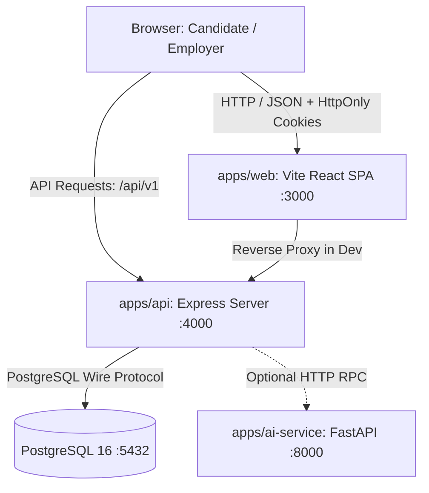
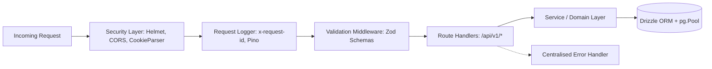

# Container and Component Design

**Date:** 2026-10-21  
**Milestone:** 1 — Engineering Foundation  
**Status:** `DECIDED`

---

## 1. System Context & Container Overview

ProofHire operates as a containerised modular monolith with distinct runtime boundaries:

### Container Responsibilities

| Container | Technology | Port | Role |
|---|---|---|---|
| `web` | React 18, Vite, TanStack Query | 3000 | SPA providing responsive dashboards for candidates, recruiters, and admins. |
| `api` | Express 4, TypeScript, Drizzle ORM | 4000 | Core business logic, auth, validation, database transactions, audit log recording. |
| `db` | PostgreSQL 16 Alpine | 5432 | Primary ACID database with relational constraints and cascade deletes. |
| `ai-service` | Python 3.11, FastAPI (Optional) | 8000 | Non-blocking summarisation and evidence extraction. Core workflows run without it. |

---

## 2. API Component Architecture (`apps/api`)

The API follows a layered architecture with explicit boundaries:

### Component Breakdown

1. **Security & Protocol Layer:**
   - `helmet`: Sets secure HTTP headers (CSP, HSTS, X-Content-Type-Options).
   - `cors`: Strictly whitelists client origin with `credentials: true`.
   - `cookie-parser`: Signed/parsed cookie handler for HttpOnly session cookies.

2. **Observability Layer:**
   - `requestLogger`: Generates or propagates `x-request-id` correlation IDs. Tracks execution latency and response status.
   - `logger`: Structured Pino logger outputting JSON in production and human-readable logs in local development.

3. **Validation Boundary:**
   - `validateRequest`: Zod schemas validate `req.body`, `req.query`, and `req.params`. Any schema violation aborts immediately with a 400 `VALIDATION_ERROR` without touching downstream domain logic.

4. **Persistence Layer:**
   - PostgreSQL connection pool (`max: 20`) managed by `pg.Pool`.
   - Type-safe queries and relation mapping via `drizzle-orm`.
   - Health check probes test connection readiness via `SELECT 1`.

---

## 3. Shared Contracts Layer (`packages/shared-contracts`)

To maintain end-to-end type safety between frontend, backend, and external consumers, all data transfer objects (DTOs) and domain enums live in a shared package:

- **Envelopes:** `ApiResponse<T>`, `ApiSuccessResponse<T>`, `ApiErrorResponse`, `PaginationMeta`
- **Domain Enums:** `UserRole`, `AccountStatus`, `OrgRole`, `CandidateStatus`, `CandidateVisibility`
- **Schemas & DTOs:** Zod schemas and inferred types for Auth, Probes, and Profile contracts.
