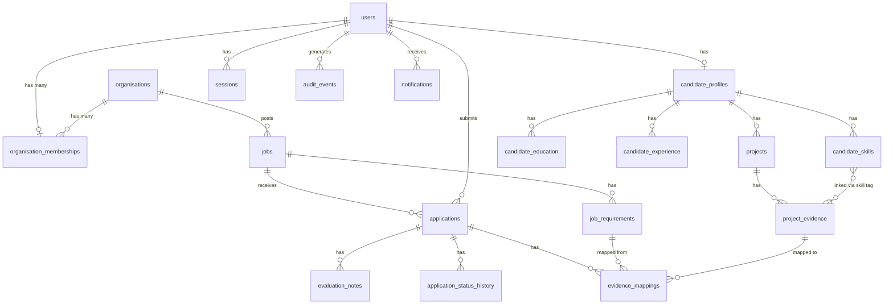
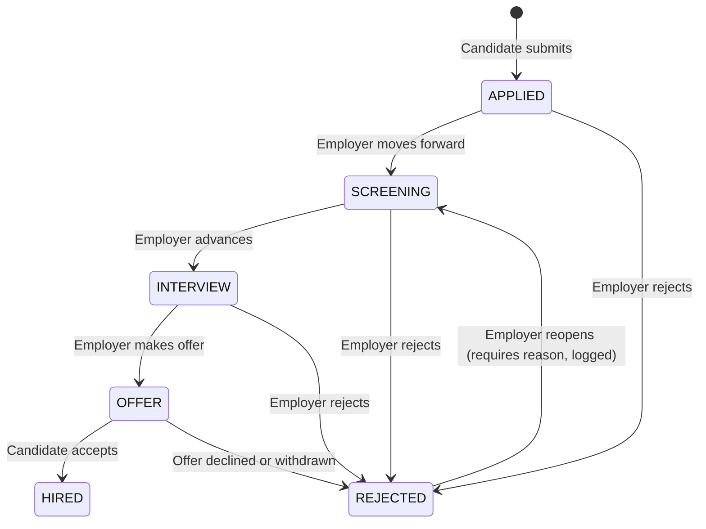

# Data Model

> **Status:** `PROPOSED` — the schema will be implemented incrementally through migrations starting in Milestone 1.
> Table names use `snake_case` (PostgreSQL convention).
> All timestamps are `TIMESTAMPTZ` (UTC with time zone) unless stated otherwise.

---

## 1. Entity Relationship Overview



---

## 2. Table Definitions

### 2.1 `users`

```sql
CREATE TABLE users (
  id              UUID PRIMARY KEY DEFAULT gen_random_uuid(),
  email           TEXT NOT NULL UNIQUE,
  password_hash   TEXT NOT NULL,
  role            TEXT NOT NULL CHECK (role IN ('CANDIDATE', 'EMPLOYER', 'ADMIN')),
  full_name       TEXT NOT NULL,
  email_verified  BOOLEAN NOT NULL DEFAULT FALSE,
  account_status  TEXT NOT NULL DEFAULT 'ACTIVE' CHECK (account_status IN ('ACTIVE', 'WARNED', 'SUSPENDED', 'BANNED')),
  created_at      TIMESTAMPTZ NOT NULL DEFAULT NOW(),
  updated_at      TIMESTAMPTZ NOT NULL DEFAULT NOW()
);

CREATE INDEX idx_users_email ON users (email);
CREATE INDEX idx_users_role ON users (role);
```

**Constraints:**
- `email` is globally unique — one account per email address, regardless of role.
- `password_hash` stores only the Argon2id hash, never the plaintext.
- `role` is an enum-validated text column; a proper `CREATE TYPE` may be used in the migration.

**Retention:** Users who delete their account enter `DELETED` status. A data purge job removes PII after the retention window (to be defined per DPDP Act requirements).

---

### 2.2 `sessions`

```sql
CREATE TABLE sessions (
  id             UUID PRIMARY KEY DEFAULT gen_random_uuid(),
  user_id        UUID NOT NULL REFERENCES users(id) ON DELETE CASCADE,
  token_hash     TEXT NOT NULL UNIQUE,  -- SHA-256 of the raw session token
  expires_at     TIMESTAMPTZ NOT NULL,
  ip_address     INET,                  -- For audit; not used for auth decisions
  user_agent     TEXT,
  created_at     TIMESTAMPTZ NOT NULL DEFAULT NOW()
);

CREATE INDEX idx_sessions_user_id ON sessions (user_id);
CREATE INDEX idx_sessions_expires_at ON sessions (expires_at);
```

**Notes:**
- Raw token is never stored. Only the SHA-256 hash is persisted.
- Expired sessions are cleaned up by a periodic job (simple DELETE WHERE expires_at < NOW()).

---

### 2.3 `organisations`

```sql
CREATE TABLE organisations (
  id              UUID PRIMARY KEY DEFAULT gen_random_uuid(),
  name            TEXT NOT NULL,
  slug            TEXT NOT NULL UNIQUE,
  website         TEXT,
  description     TEXT,
  size_range      TEXT CHECK (size_range IN ('1-10', '11-50', '51-200', '201-500', '500+')),
  industry        TEXT,
  headquarters    TEXT,
  logo_url        TEXT,
  verified        BOOLEAN NOT NULL DEFAULT FALSE,
  created_at      TIMESTAMPTZ NOT NULL DEFAULT NOW(),
  updated_at      TIMESTAMPTZ NOT NULL DEFAULT NOW()
);

CREATE INDEX idx_organisations_slug ON organisations (slug);
```

---

### 2.4 `organisation_memberships`

```sql
CREATE TABLE organisation_memberships (
  id              UUID PRIMARY KEY DEFAULT gen_random_uuid(),
  organisation_id UUID NOT NULL REFERENCES organisations(id) ON DELETE CASCADE,
  user_id         UUID NOT NULL REFERENCES users(id) ON DELETE CASCADE,
  org_role        TEXT NOT NULL CHECK (org_role IN ('OWNER', 'ADMIN', 'MEMBER')),
  invited_by      UUID REFERENCES users(id),
  accepted_at     TIMESTAMPTZ,
  created_at      TIMESTAMPTZ NOT NULL DEFAULT NOW(),
  UNIQUE (organisation_id, user_id)
);

CREATE INDEX idx_org_memberships_user_id ON organisation_memberships (user_id);
CREATE INDEX idx_org_memberships_org_id ON organisation_memberships (organisation_id);
```

---

### 2.5 `candidate_profiles`

```sql
CREATE TABLE candidate_profiles (
  id              UUID PRIMARY KEY DEFAULT gen_random_uuid(),
  user_id         UUID NOT NULL UNIQUE REFERENCES users(id) ON DELETE CASCADE,
  bio             TEXT CHECK (char_length(bio) <= 500),
  location_city   TEXT,
  location_country TEXT,
  status          TEXT CHECK (status IN ('STUDENT', 'ACTIVELY_LOOKING', 'OPEN', 'NOT_LOOKING')),
  visibility      TEXT NOT NULL DEFAULT 'PUBLIC' CHECK (visibility IN ('PUBLIC', 'APPLIED_ONLY', 'PRIVATE')),
  years_experience SMALLINT CHECK (years_experience >= 0 AND years_experience <= 50),
  created_at      TIMESTAMPTZ NOT NULL DEFAULT NOW(),
  updated_at      TIMESTAMPTZ NOT NULL DEFAULT NOW()
);
```

---

### 2.6 `candidate_education`

```sql
CREATE TABLE candidate_education (
  id              UUID PRIMARY KEY DEFAULT gen_random_uuid(),
  candidate_id    UUID NOT NULL REFERENCES candidate_profiles(id) ON DELETE CASCADE,
  institution     TEXT NOT NULL,
  degree          TEXT,
  field_of_study  TEXT,
  start_year      SMALLINT,
  end_year        SMALLINT,
  description     TEXT,
  sort_order      SMALLINT NOT NULL DEFAULT 0,
  created_at      TIMESTAMPTZ NOT NULL DEFAULT NOW()
);

CREATE INDEX idx_education_candidate ON candidate_education (candidate_id);
```

---

### 2.7 `candidate_experience`

```sql
CREATE TABLE candidate_experience (
  id              UUID PRIMARY KEY DEFAULT gen_random_uuid(),
  candidate_id    UUID NOT NULL REFERENCES candidate_profiles(id) ON DELETE CASCADE,
  company_name    TEXT NOT NULL,
  role_title      TEXT NOT NULL,
  employment_type TEXT CHECK (employment_type IN ('FULL_TIME', 'INTERNSHIP', 'FREELANCE', 'PART_TIME', 'CONTRACT')),
  start_date      DATE NOT NULL,
  end_date        DATE,             -- NULL means current
  is_current      BOOLEAN NOT NULL DEFAULT FALSE,
  responsibilities TEXT,
  technologies    TEXT[],
  sort_order      SMALLINT NOT NULL DEFAULT 0,
  created_at      TIMESTAMPTZ NOT NULL DEFAULT NOW()
);

CREATE INDEX idx_experience_candidate ON candidate_experience (candidate_id);
```

---

### 2.8 `candidate_skills`

```sql
CREATE TABLE candidate_skills (
  id              UUID PRIMARY KEY DEFAULT gen_random_uuid(),
  candidate_id    UUID NOT NULL REFERENCES candidate_profiles(id) ON DELETE CASCADE,
  skill_name      TEXT NOT NULL,
  proficiency     TEXT NOT NULL CHECK (proficiency IN ('BEGINNER', 'INTERMEDIATE', 'ADVANCED')),
  is_self_reported BOOLEAN NOT NULL DEFAULT TRUE,
  created_at      TIMESTAMPTZ NOT NULL DEFAULT NOW(),
  UNIQUE (candidate_id, skill_name)
);

CREATE INDEX idx_skills_candidate ON candidate_skills (candidate_id);
CREATE INDEX idx_skills_name ON candidate_skills (skill_name);
```

---

### 2.9 `projects`

```sql
CREATE TABLE projects (
  id                  UUID PRIMARY KEY DEFAULT gen_random_uuid(),
  candidate_id        UUID NOT NULL REFERENCES candidate_profiles(id) ON DELETE CASCADE,
  name                TEXT NOT NULL,
  description         TEXT NOT NULL,
  role_in_project     TEXT NOT NULL CHECK (role_in_project IN ('SOLE_DEVELOPER', 'LEAD', 'CONTRIBUTOR', 'REVIEWER')),
  team_size           SMALLINT,
  personal_contribution TEXT NOT NULL,  -- Required: must describe what the candidate personally did
  github_url          TEXT,
  project_url         TEXT,
  demo_url            TEXT,
  is_team_project     BOOLEAN NOT NULL DEFAULT FALSE,
  start_date          DATE,
  end_date            DATE,
  sort_order          SMALLINT NOT NULL DEFAULT 0,
  created_at          TIMESTAMPTZ NOT NULL DEFAULT NOW(),
  updated_at          TIMESTAMPTZ NOT NULL DEFAULT NOW()
);

CREATE INDEX idx_projects_candidate ON projects (candidate_id);
```

---

### 2.10 `project_evidence`

```sql
CREATE TABLE project_evidence (
  id                UUID PRIMARY KEY DEFAULT gen_random_uuid(),
  project_id        UUID NOT NULL REFERENCES projects(id) ON DELETE CASCADE,
  evidence_type     TEXT NOT NULL CHECK (evidence_type IN ('URL', 'GITHUB_URL', 'UPLOADED_FILE', 'VIDEO_LINK', 'WRITTEN_EXPLANATION')),
  title             TEXT NOT NULL,
  description       TEXT NOT NULL,
  url               TEXT,
  file_path         TEXT,           -- Internal path; not exposed directly to clients
  personal_contribution TEXT NOT NULL,  -- Candidate's specific contribution to this evidence
  is_self_reported  BOOLEAN NOT NULL DEFAULT TRUE,
  skill_tags        TEXT[],         -- Skills this evidence demonstrates
  created_at        TIMESTAMPTZ NOT NULL DEFAULT NOW(),
  updated_at        TIMESTAMPTZ NOT NULL DEFAULT NOW()
);

CREATE INDEX idx_evidence_project ON project_evidence (project_id);
CREATE INDEX idx_evidence_skill_tags ON project_evidence USING GIN (skill_tags);
```

---

### 2.11 `jobs`

```sql
CREATE TABLE jobs (
  id              UUID PRIMARY KEY DEFAULT gen_random_uuid(),
  organisation_id UUID NOT NULL REFERENCES organisations(id) ON DELETE CASCADE,
  created_by      UUID NOT NULL REFERENCES users(id),
  title           TEXT NOT NULL,
  description     TEXT NOT NULL,
  employment_type TEXT NOT NULL CHECK (employment_type IN ('FULL_TIME', 'INTERNSHIP', 'CONTRACT', 'PART_TIME')),
  location_city   TEXT,
  location_country TEXT,
  remote_type     TEXT NOT NULL DEFAULT 'ONSITE' CHECK (remote_type IN ('ONSITE', 'REMOTE', 'HYBRID')),
  salary_min      INTEGER,
  salary_max      INTEGER,
  salary_currency TEXT DEFAULT 'INR',
  application_deadline DATE,
  status          TEXT NOT NULL DEFAULT 'DRAFT' CHECK (status IN ('DRAFT', 'PUBLISHED', 'CLOSED', 'ARCHIVED')),
  published_at    TIMESTAMPTZ,
  closed_at       TIMESTAMPTZ,
  created_at      TIMESTAMPTZ NOT NULL DEFAULT NOW(),
  updated_at      TIMESTAMPTZ NOT NULL DEFAULT NOW()
);

CREATE INDEX idx_jobs_organisation ON jobs (organisation_id);
CREATE INDEX idx_jobs_status ON jobs (status);
CREATE INDEX idx_jobs_published_at ON jobs (published_at DESC) WHERE status = 'PUBLISHED';
```

---

### 2.12 `job_requirements`

```sql
CREATE TABLE job_requirements (
  id              UUID PRIMARY KEY DEFAULT gen_random_uuid(),
  job_id          UUID NOT NULL REFERENCES jobs(id) ON DELETE CASCADE,
  requirement_text TEXT NOT NULL,
  importance      TEXT NOT NULL CHECK (importance IN ('REQUIRED', 'PREFERRED')),
  evidence_type_hint TEXT,          -- e.g., "Show a deployed REST API", "Link to a testing file"
  skill_tags      TEXT[],           -- Tags for automated matching
  sort_order      SMALLINT NOT NULL DEFAULT 0,
  created_at      TIMESTAMPTZ NOT NULL DEFAULT NOW()
);

CREATE INDEX idx_job_requirements_job ON job_requirements (job_id);
CREATE INDEX idx_job_requirements_tags ON job_requirements USING GIN (skill_tags);
```

---

### 2.13 `applications`

```sql
CREATE TABLE applications (
  id              UUID PRIMARY KEY DEFAULT gen_random_uuid(),
  job_id          UUID NOT NULL REFERENCES jobs(id),
  candidate_id    UUID NOT NULL REFERENCES users(id),
  cover_note      TEXT CHECK (char_length(cover_note) <= 1000),
  status          TEXT NOT NULL DEFAULT 'APPLIED' CHECK (status IN ('APPLIED', 'SCREENING', 'INTERVIEW', 'OFFER', 'HIRED', 'REJECTED')),
  created_at      TIMESTAMPTZ NOT NULL DEFAULT NOW(),
  updated_at      TIMESTAMPTZ NOT NULL DEFAULT NOW(),
  UNIQUE (job_id, candidate_id)     -- One application per candidate per job
);

CREATE INDEX idx_applications_job ON applications (job_id);
CREATE INDEX idx_applications_candidate ON applications (candidate_id);
CREATE INDEX idx_applications_status ON applications (status);
```

---

### 2.14 `application_status_history`

```sql
CREATE TABLE application_status_history (
  id              UUID PRIMARY KEY DEFAULT gen_random_uuid(),
  application_id  UUID NOT NULL REFERENCES applications(id) ON DELETE CASCADE,
  from_status     TEXT,             -- NULL for the initial 'APPLIED' entry
  to_status       TEXT NOT NULL,
  changed_by      UUID NOT NULL REFERENCES users(id),
  reason          TEXT,
  created_at      TIMESTAMPTZ NOT NULL DEFAULT NOW()
);

CREATE INDEX idx_app_history_application ON application_status_history (application_id);
```

---

### 2.15 `evaluation_notes`

```sql
CREATE TABLE evaluation_notes (
  id              UUID PRIMARY KEY DEFAULT gen_random_uuid(),
  application_id  UUID NOT NULL REFERENCES applications(id) ON DELETE CASCADE,
  author_id       UUID NOT NULL REFERENCES users(id),
  content         TEXT NOT NULL,
  is_internal     BOOLEAN NOT NULL DEFAULT TRUE,   -- Candidates never see internal notes
  created_at      TIMESTAMPTZ NOT NULL DEFAULT NOW(),
  updated_at      TIMESTAMPTZ NOT NULL DEFAULT NOW()
);

CREATE INDEX idx_eval_notes_application ON evaluation_notes (application_id);
```

---

### 2.16 `evidence_mappings`

Cached or computed mappings between job requirements and evidence items. Recomputed when profile or job changes.

```sql
CREATE TABLE evidence_mappings (
  id                  UUID PRIMARY KEY DEFAULT gen_random_uuid(),
  application_id      UUID NOT NULL REFERENCES applications(id) ON DELETE CASCADE,
  job_requirement_id  UUID NOT NULL REFERENCES job_requirements(id) ON DELETE CASCADE,
  project_evidence_id UUID REFERENCES project_evidence(id) ON DELETE SET NULL,
  relevance_score     NUMERIC(5, 4),   -- 0.0 to 1.0; NULL if no evidence found
  relevance_reason    TEXT,
  is_ai_assisted      BOOLEAN NOT NULL DEFAULT FALSE,
  ai_model_version    TEXT,
  computed_at         TIMESTAMPTZ NOT NULL DEFAULT NOW(),
  UNIQUE (application_id, job_requirement_id, project_evidence_id)
);

CREATE INDEX idx_evidence_mappings_application ON evidence_mappings (application_id);
CREATE INDEX idx_evidence_mappings_requirement ON evidence_mappings (job_requirement_id);
```

---

### 2.17 `audit_events`

Immutable log of sensitive platform actions. Records are never deleted through normal application flows.

```sql
CREATE TABLE audit_events (
  id              UUID PRIMARY KEY DEFAULT gen_random_uuid(),
  event_type      TEXT NOT NULL,
  actor_id        UUID REFERENCES users(id),   -- NULL for system events
  target_type     TEXT,                         -- e.g., 'USER', 'APPLICATION', 'JOB'
  target_id       UUID,
  metadata        JSONB,
  ip_address      INET,
  created_at      TIMESTAMPTZ NOT NULL DEFAULT NOW()
);

CREATE INDEX idx_audit_events_actor ON audit_events (actor_id);
CREATE INDEX idx_audit_events_target ON audit_events (target_type, target_id);
CREATE INDEX idx_audit_events_type ON audit_events (event_type);
CREATE INDEX idx_audit_events_created_at ON audit_events (created_at DESC);
```

**Event types (initial set):**
- `AUTH_LOGIN_SUCCESS`
- `AUTH_LOGIN_FAILURE`
- `AUTH_LOGOUT`
- `AUTH_PASSWORD_RESET_REQUEST`
- `AUTH_PASSWORD_RESET_COMPLETE`
- `ACCOUNT_STATUS_CHANGED`
- `ADMIN_DATA_ACCESS`
- `JOB_PUBLISHED`
- `JOB_CLOSED`
- `APPLICATION_STATUS_CHANGED`
- `CONTENT_REPORTED`

---

### 2.18 `notifications`

```sql
CREATE TABLE notifications (
  id              UUID PRIMARY KEY DEFAULT gen_random_uuid(),
  user_id         UUID NOT NULL REFERENCES users(id) ON DELETE CASCADE,
  type            TEXT NOT NULL,
  title           TEXT NOT NULL,
  body            TEXT,
  metadata        JSONB,
  read_at         TIMESTAMPTZ,
  created_at      TIMESTAMPTZ NOT NULL DEFAULT NOW()
);

CREATE INDEX idx_notifications_user ON notifications (user_id, read_at) WHERE read_at IS NULL;
```

---

### 2.19 `content_reports`

```sql
CREATE TABLE content_reports (
  id              UUID PRIMARY KEY DEFAULT gen_random_uuid(),
  reporter_id     UUID NOT NULL REFERENCES users(id),
  target_type     TEXT NOT NULL CHECK (target_type IN ('JOB', 'CANDIDATE_PROFILE', 'ORGANISATION')),
  target_id       UUID NOT NULL,
  reason_category TEXT NOT NULL CHECK (reason_category IN ('FALSE_INFORMATION', 'ABUSIVE_CONTENT', 'IMPERSONATION', 'SPAM', 'OTHER')),
  detail          TEXT,
  status          TEXT NOT NULL DEFAULT 'PENDING' CHECK (status IN ('PENDING', 'REVIEWED', 'ACTIONED', 'DISMISSED')),
  reviewed_by     UUID REFERENCES users(id),
  reviewed_at     TIMESTAMPTZ,
  created_at      TIMESTAMPTZ NOT NULL DEFAULT NOW()
);

CREATE INDEX idx_reports_status ON content_reports (status) WHERE status = 'PENDING';
CREATE INDEX idx_reports_target ON content_reports (target_type, target_id);
```

---

## 3. Application State Machine



**Invariants enforced by server:**
- Only the valid transitions above are permitted.
- Every transition is recorded in `application_status_history`.
- Reopening from `REJECTED` requires an explicit reason and generates an `AUDIT_EVENT`.
- The `HIRED` state is terminal — no further transitions.

---

## 4. Indexes and Performance Notes

Key indexes for frequent query patterns:

| Query | Index |
|---|---|
| Published jobs by recency | `jobs (published_at DESC) WHERE status = 'PUBLISHED'` |
| Jobs by organisation | `jobs (organisation_id)` |
| Applications by job | `applications (job_id)` |
| Applications by candidate | `applications (candidate_id)` |
| Unread notifications | `notifications (user_id, read_at) WHERE read_at IS NULL` |
| Candidate search by skill | `candidate_skills (skill_name)` |
| Evidence by skill tag (GIN) | `project_evidence USING GIN (skill_tags)` |
| Job requirements by tag (GIN) | `job_requirements USING GIN (skill_tags)` |
| Audit log by date | `audit_events (created_at DESC)` |

> All index designs must be validated with `EXPLAIN ANALYZE` on representative datasets before Milestone 4.

---

## 5. Revision History

| Date | Author | Change |
|---|---|---|
| 2026-10-21 | ProofHire Engineering | Initial draft — complete entity model |
