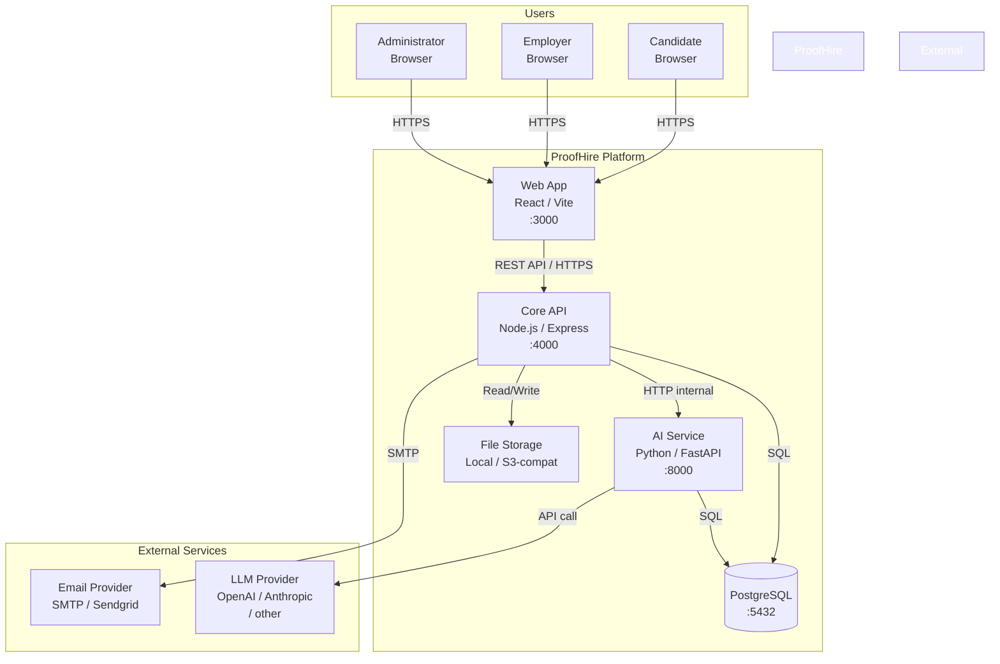

# System Context

> **Status:** `PROPOSED` — pending Milestone 1 implementation review.

---

## 1. System Context Diagram

---

## 2. Trust Boundaries

| Boundary | Description |
|---|---|
| Public internet → Web App | TLS-terminated HTTPS; no unauthenticated access to user data |
| Web App → Core API | HTTPS; session cookie required for authenticated endpoints |
| Core API → AI Service | Internal network (Docker network in dev; private VPC in production); not exposed publicly |
| Core API → PostgreSQL | Private network; credentials from environment; connection pool managed |
| AI Service → PostgreSQL | Read-only access to evidence metadata; write access to AI-generated summaries only |
| AI Service → LLM Provider | Outbound HTTPS; API key from environment secret; never exposed to clients |
| Core API → Email Provider | Outbound SMTP/HTTPS; credentials from environment secret |

---

## 3. Component Responsibilities

### Web App (React / Vite)
- Renders all user interfaces for candidates, employers, and administrators.
- Manages client-side state with TanStack Query.
- Communicates exclusively with the Core API — never directly with the AI Service or database.
- Does not store session tokens, API keys, or sensitive data in localStorage.

### Core API (Node.js / Express / TypeScript)
- Handles all authenticated and unauthenticated HTTP requests from the web app.
- Enforces authentication, authorisation, and input validation.
- Owns the primary business logic: user registration, profile management, job management, applications, evidence mapping, administration.
- Delegates AI inference requests to the AI Service with appropriate authorisation checks.
- Maintains the PostgreSQL session table and audit event log.
- Never exposes AI provider API keys to clients.

### AI Service (Python / FastAPI)
- Provides AI-powered evidence analysis, summarisation, and retrieval.
- Accepts requests from the Core API only (not directly from the web app or users).
- Calls the LLM provider on behalf of the Core API.
- Stores AI-generated artefacts (summaries, embeddings) in PostgreSQL.
- Returns source references for all factual claims.
- Returns a "Insufficient evidence" response when evidence is absent or inconclusive.
- Degraded-mode fallback: Core API handles AI service unavailability gracefully.

### PostgreSQL
- Single source of truth for all relational data.
- Enforces all database-level constraints (primary keys, foreign keys, unique constraints, check constraints).
- Hosts pgvector extension (enabled in Milestone 5 for embeddings).

### File Storage
- Stores candidate-uploaded files (PDFs, screenshots).
- Local filesystem in development; S3-compatible object storage in production.
- Files are not served directly from the API — pre-signed URLs or a proxy are used to avoid SSRF.

---

## 4. Non-Negotiable Architectural Invariants

1. **The AI service is always optional.** Core hiring workflows function fully without it.
2. **No secrets in client-side code.** API keys, session tokens beyond the cookie, and database credentials never reach the browser.
3. **Authentication is enforced in the Core API**, not in the web app. The web app may enforce it in the UI, but the API enforces it on every request.
4. **Cross-tenant isolation is enforced at the query level.** An employer's API calls never return another employer's private evaluation data, regardless of client-side manipulation.
5. **Audit events are immutable.** Sensitive administrative actions are logged and cannot be deleted through normal application flows.

---

## 5. Revision History

| Date | Author | Change |
|---|---|---|
| 2026-10-21 | ProofHire Engineering | Initial draft |
